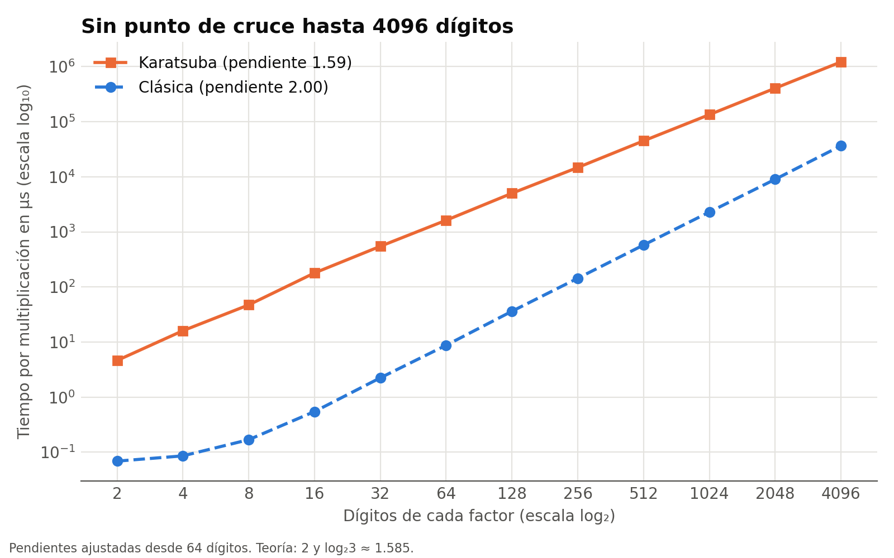

# Multiplicación rápida de enteros: algoritmo de Karatsuba

**Análisis y Diseño de Algoritmos — Práctica 2 — Universidad EAFIT**  
Javier Andres Sierra Machado · Jeronimo Velez Acosta  
Repositorio: `jero020/karatsuba-multiplicacion-rapida`

## 1. Deducción de la identidad

Para multiplicar dos enteros de muchos dígitos, dividimos cada número en una parte alta y una parte baja. Si la parte baja ocupa m posiciones decimales, escribimos:

$$x = x_1 10^m + x_0, \qquad y = y_1 10^m + y_0.$$

Al desarrollar el producto obtenemos:

$$xy = x_1y_1 10^{2m} + (x_1y_0 + x_0y_1)10^m + x_0y_0.$$

Una implementación directa de esta expresión necesita cuatro multiplicaciones entre las partes: las dos de los extremos y las dos del término central. Karatsuba calcula estos tres productos:

$$P_1=x_1y_1, \qquad P_2=x_0y_0, \qquad P_3=(x_1+x_0)(y_1+y_0).$$

Desarrollamos el tercero para recuperar los términos que faltan:

$$P_3 = x_1y_1+x_1y_0+x_0y_1+x_0y_0.$$

Por tanto,

$$P_3-P_1-P_2=x_1y_0+x_0y_1.$$

La recomposición queda:

$$xy=P_1 10^{2m}+(P_3-P_1-P_2)10^m+P_2.$$

Con esta identidad calculamos tres productos recursivos. A cambio, hacemos sumas y restas sobre los dígitos. Por ejemplo, para 12 por 34, con m = 1, tenemos P1 = 3, P2 = 8 y P3 = 21. El término central vale 21 - 3 - 8 = 10; al recomponer obtenemos 300 + 100 + 8 = 408.

## 2. Recurrencia

### 2.1 Teorema Maestro

Tomamos n como la cantidad de dígitos del operando más largo. En el modelo de partición por mitades, cada llamada calcula tres productos de tamaño cercano a n/2. Las sumas, restas, copias y desplazamientos recorren una cantidad de dígitos proporcional a n. La recurrencia que usamos para el análisis es:

$$T(n)=3T(n/2)+\Theta(n), \qquad T(1)=\Theta(1).$$

En el Teorema Maestro identificamos a = 3, b = 2 y f(n) = Θ(n). Comparamos el trabajo fuera de la recursión con:

$$n^{\log_b a}=n^{\log_2 3}\approx n^{1.585}.$$

Como 1 < log₂3, el costo lineal crece más despacio por un factor polinómico. Podemos escoger ε = log₂3 - 1 > 0 para escribir:

$$f(n)=\Theta(n)=O\left(n^{\log_2 3-\varepsilon}\right).$$

Aplicamos el caso 1 del Teorema Maestro y concluimos:

$$T(n)=\Theta\left(n^{\log_2 3}\right).$$

El exponente log₂3 relaciona los tres subproblemas con la reducción a la mitad de su tamaño. Con cuatro productos tendríamos T(n) = 4T(n/2) + Θ(n), cuyo resultado sería Θ(n²), el mismo orden del método clásico.

La recurrencia anterior simplifica los redondeos y el acarreo de las sumas. En el código, las partes pueden tener tamaños distintos y una suma de mitades puede crecer un dígito. Por eso no afirmamos que cada llamada trabaje sobre exactamente n/2 dígitos: algunos operandos alcanzan ⌈n/2⌉ + 1. Ese incremento acotado no cambia el exponente asintótico; para aplicarlo al código distinguimos este detalle del modelo ideal por mitades.

### 2.2 Árbol de recurrencia

El Teorema Maestro da el resultado; el árbol muestra de dónde sale. Sea c la constante del trabajo lineal de una llamada.

| Nivel | Subproblemas | Tamaño | Costo de cada uno | Costo del nivel |
|:---:|:---:|:---:|:---:|:---:|
| 0 | 1 | n | cn | cn |
| 1 | 3 | n/2 | cn/2 | cn(3/2) |
| i | 3ⁱ | n/2ⁱ | cn/2ⁱ | cn(3/2)ⁱ |
| log₂n | 3log₂n | 1 | c | c·3log₂n |

La altura es log₂n, porque el tamaño se reduce a la mitad hasta llegar a 1. El costo total es una suma geométrica de razón 3/2:

$$T(n)=cn\sum_{i=0}^{\log_2 n}\left(\frac{3}{2}\right)^i = 3c\,n^{\log_2 3}-2cn=\Theta\left(n^{\log_2 3}\right).$$

Como la razón es mayor que 1, cada nivel cuesta más que el anterior y la suma la dominan las hojas. Su número explica el exponente: 3log₂n = nlog₂3, porque cada nivel triplica los subproblemas y hay log₂n niveles. Con cuatro productos la razón sería 4/2 = 2 y habría 4log₂n = n² hojas. Quitar un solo producto cambia el exponente, y por eso el ahorro no es solo una mejora constante.

## 3. Representación e implementación

Representamos cada entero no negativo con un `std::vector<int>` en base 10. Guardamos las unidades en la posición 0. Por ejemplo, 1203 corresponde a `{3, 0, 2, 1}`. Así recorremos el vector desde el inicio para propagar acarreos y préstamos.

`normalizar` elimina ceros sobrantes del final del vector y conserva `{0}` para el cero. `desdeString` recorre la cadena desde el último carácter, verifica que contenga dígitos y normaliza el resultado. `aString` recorre los dígitos en el orden contrario para producir la escritura decimal habitual.

En `sumar` recorremos la longitud del operando más largo. Cuando un operando ya no tiene dígitos, usamos cero en esa posición. Guardamos el residuo módulo 10 y llevamos el cociente como acarreo. Si queda un acarreo al terminar, agregamos otro dígito. Esto permite, por ejemplo, sumar 999 + 1 y obtener 1000.

`restar` requiere que el primer operando sea mayor o igual que el segundo. En cada posición descontamos el préstamo anterior. Si la diferencia es negativa, sumamos 10 y trasladamos un préstamo a la siguiente posición. Al terminar normalizamos el resultado. La función lanza una excepción si queda un préstamo final, porque eso indica que se incumplió la precondición. La suma y la resta tienen costo lineal en la longitud del operando más largo.

`desplazar(a, k)` multiplica por 10k insertando k ceros en las posiciones bajas, con costo lineal. `partir(a, m, alta, baja)` copia los dígitos [0, m) en la parte baja y los restantes en la alta. No normaliza: conservar los ceros mantiene las longitudes, y el valor se recupera con alta·10m + baja.

`multiplicacionClasica` reserva n + m dígitos, el máximo posible, y suma cada producto a[i]·b[j] en la posición i + j, propagando el acarreo. Cada paso suma como máximo 9 + 81 + 8 = 98, así que un `int` basta. Sus dos ciclos anidados dan Θ(n²).

La función pública `karatsuba` copia y normaliza los operandos. Si uno es cero, devuelve `{0}`. Después busca la menor potencia de 2 que cubre ambas longitudes y rellena con ceros hasta igualarlas. Como usamos los dígitos en orden inverso, agrega esos ceros al final del vector.

La función interna `karatsubaRec` recibe copias que puede redimensionar sin modificar los operandos originales. Toma n como la mayor longitud de la llamada y completa el operando más corto con ceros. Si n = 1, multiplica los dos dígitos: el producto está entre 0 y 81 y cabe en un `int`. Lo convierte a uno o dos dígitos. No usamos tipos nativos para representar el producto de números grandes.

Para n mayor que 1, tomamos m = ⌊n/2⌋ y usamos `partir` para obtener las partes altas y bajas. Calculamos P1, P2 y P3 con llamadas recursivas. Las sumas de las partes pueden tener un dígito adicional; conservamos ese dígito y dejamos que la llamada siguiente adapte las longitudes. No truncamos los resultados para forzarlos al tamaño inicial.

Calculamos el término central como `restar(restar(p3, p1), p2)`. Este orden respeta la precondición de la resta, pues:

$$P_3-P_1=P_2+x_1y_0+x_0y_1\geq P_2.$$

Así, las dos restas producen valores no negativos. Por último, desplazamos P1 en 2m posiciones y el término central en m posiciones, y sumamos ambos con P2. La función pública normaliza el producto antes de devolverlo.

## 4. Validación

`src/tests.cpp` ejecuta 134 casos, todos correctos, y exige que ambos algoritmos den el valor esperado: 100 productos de 1 dígito (incluidos 0 × 9 y 9 × 9), ceros a la izquierda (`000123 × 45`), ceros intercalados (`100200300 × 4005`), longitudes impares de 3, 5 y 7 dígitos, conversiones y 10 productos de hasta 1555 dígitos. En los productos grandes, el valor esperado sale de una fórmula, como (10ⁿ − 1)², salvo en uno, donde Karatsuba se compara contra el clásico.

Para comprobar que las pruebas detectan errores, introdujimos cinco fallos en copias temporales del código, como perder el dígito extra de P3 o desplazar mal el término central; las pruebas detectaron los cinco. Fuera del repositorio comparamos además ambos algoritmos contra los enteros de Python en 1011 pares, 1000 de ellos aleatorios de hasta 400 dígitos, sin ninguna diferencia.

## 5. Análisis experimental

**Montaje.** Intel Core i7-9750H a 2.60 GHz, 16 GB de RAM, macOS 26.3.1, Apple clang 21 con `-std=c++17 -O2`. Medimos de 2 a 4096 dígitos en potencias de 2, con un par de números de exactamente n dígitos generado con semilla fija para cada tamaño. Con `std::chrono::steady_clock`, duplicamos un lote de multiplicaciones hasta que dura al menos 100 ms y promediamos ese lote, muy por encima de la resolución del reloj. Repetimos esta medición 5 veces y guardamos la mediana, para resistir picos causados por otros programas. El resultado se acumula en un checksum que se imprime, para que el compilador no elimine el cálculo. Hicimos las corridas anteriores con el computador en uso y variaron hasta 25 %; por eso reportamos una corrida hecha con los demás programas cerrados.

| Dígitos | Clásica (µs) | Karatsuba (µs) | Karatsuba / Clásica |
|---:|---:|---:|---:|
| 2 | 0.069 | 4.624 | 67 |
| 4 | 0.086 | 16.048 | 187 |
| 8 | 0.169 | 47.208 | 280 |
| 16 | 0.547 | 179.561 | 329 |
| 32 | 2.239 | 547.283 | 244 |
| 64 | 8.740 | 1625.186 | 186 |
| 128 | 36.200 | 5023.451 | 139 |
| 256 | 143.957 | 14764.826 | 103 |
| 512 | 577.368 | 44963.579 | 78 |
| 1024 | 2293.154 | 134518.425 | 59 |
| 2048 | 9017.030 | 406339.209 | 45 |
| 4096 | 36634.252 | 1219131.771 | 33 |

**Orden de crecimiento.** Desde 32 dígitos, al duplicar el tamaño el clásico tarda unas 4 veces más y Karatsuba unas 3, los factores 2² y 2log₂3. Ajustando una recta en escala log-log desde 64 dígitos, las pendientes son 2.00 y 1.59, frente a 2 y 1.585 de la teoría. Excluimos los tamaños menores porque allí domina el costo fijo de cada llamada.

**Punto de cruce.** No aparece en el rango medido: en 4096 dígitos, Karatsuba sigue siendo 33 veces más lenta. La razón baja desde 16 dígitos, de 329 a 33, así que la ventaja asintótica sí se observa, pero no alcanza. Si las pendientes se mantuvieran, el cruce llegaría hacia las decenas de millones de dígitos; es una extrapolación, no una medición.

**Por qué el clásico gana.** El orden asintótico oculta las constantes, y aquí son muy distintas. Contamos las llamadas recursivas: para 4096 dígitos son 1 543 363, lo que da unos 0.79 µs por llamada, valor estable desde 64 dígitos. El clásico gasta unos 2.2 ns por producto de dígitos, unas 360 veces menos. Esto concuerda con la implementación: cada llamada crea y copia varios vectores, pide memoria, revisa si los operandos son cero y hace sumas y restas, mientras que el clásico reserva memoria una vez y recorre arreglos con operaciones simples. No medimos por separado cuánto aporta cada uno de esos costos. Además, la recursión baja hasta 1 dígito, donde hacer todo ese trabajo no compensa. Por eso, en números pequeños el clásico es mucho más rápido: tener menor orden solo garantiza ganar a partir de algún tamaño. Un caso base mayor que use el clásico, que el enunciado permite, debería acercar el cruce, aunque no lo medimos.

**Limitaciones.** Usamos un solo par de números por tamaño y un solo equipo, y el cruce extrapolado depende de ambos.

## 6. Conclusiones

La identidad de Karatsuba cambia cuatro productos por tres, y eso baja el exponente de 2 a log₂3 ≈ 1.585, como muestran el Teorema Maestro, el árbol y las pendientes medidas de 2.00 y 1.59. Aun así, nuestra implementación no supera al clásico hasta 4096 dígitos, por sus constantes. La lección es distinguir la complejidad asintótica del rendimiento real: el orden predice cómo crece el tiempo, no cuál algoritmo es más rápido en un tamaño dado.

## 7. Dificultades

- **Comprobar sin engañarnos.** `aString` normaliza al imprimir y escondía resultados con ceros de sobra, así que las pruebas pasaron a comparar vectores.
- **Ruido en las mediciones.** Una corrida dio casi el doble en 64 dígitos y bajó la pendiente a 1.51. Por eso adoptamos la mediana y una corrida con el equipo libre.
- **Integración.** Ambos creamos `src/bigint.cpp` por separado y hubo un conflicto de git, que resolvimos conservando las funciones de los dos.
- **Autoría en el historial.** Los commits `415c084` y `161534e` son de Javier, pero figuran con el autor `jero020` por un error de configuración de git, aparentemente causado por la herramienta de IA que usaba; la página Activity del repositorio muestra que los subió desde su cuenta, y sus commits posteriores ya salen a su nombre.
- **[COMPLETAR: dificultades de Javier y de Jeronimo con sus propias palabras]**

## 8. Declaración de uso de IA

- **Jeronimo Velez Acosta:** usó Claude (Claude Code, modelo Opus 5.5) en la parte B. Claude escribió `desplazar`, `partir`, `multiplicacionClasica`, `tests.cpp`, `benchmark.cpp` y `graficar.py`, explicó cada función, actualizó el README y redactó la primera versión de las secciones 2.2, 4, 5, 6 y 7, y de los párrafos sobre esas funciones en la sección 3. Jeronimo pidió la explicación de cada función, aprobó cada paso y tomó las decisiones de usar la mediana, no incluir pruebas aleatorias, usar Python solo para la gráfica y no reescribir el historial de commits. Hasta esta versión, el código y esas secciones son los que generó Claude.
- **Javier Andres Sierra Machado:** **[COMPLETAR: qué herramienta usó y para qué]**.
